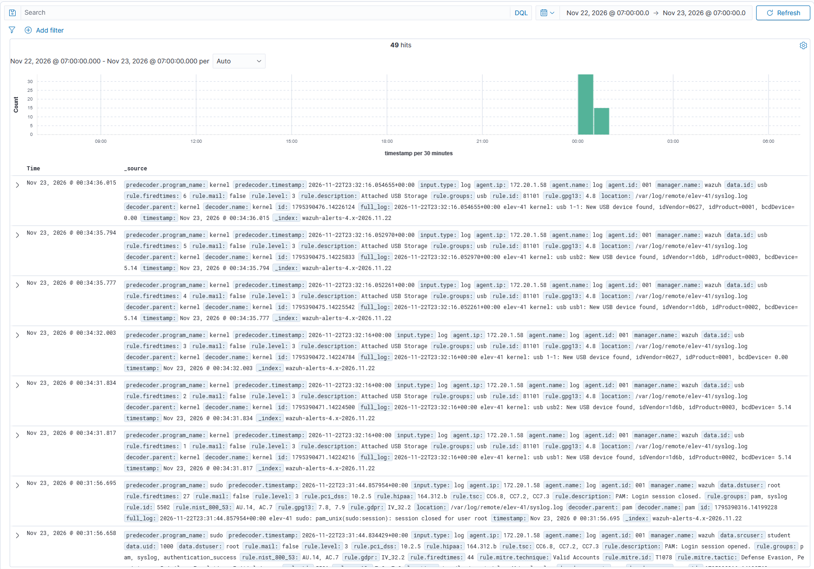

# Playbook

## T1110 Brute Force
| Fält | Värde |
|---|---|
| Detektion (monitor) | T1110 Brute Force elev-18 |
| ATT&CK-teknik | T1110 |
| Wazuh-regler (rule.id) | 5710 & 5712 |
| Ägare | elev-18 |
| Senast korstestad | elev-18 · 11/24/2026 |
| Version | 1 |

### Syfte och när den används
**Syfte:** Kollar efter angripare på elev-18 och används när det sker en trigger på 5710 eller 5712.

### Fas 1. Förberedelse (ska vara sant *före* ett larm)
- [ ] Monitorn är *Enabled* i Alerting.
- [ ] Loggkällan syns i Discover (`location`, index `wazuh-alerts-*`).
- [ ] Normal träffmängd är känd: ~50 per 24 timmar (från brusmätningen). 
- [ ] Kända legitima källor: jump 172.20.1.2, ctf 172.20.1.10
- [ ] Du har åtkomst till: Wazuh, jump, elev-XX.

### Fas 2. Detektion och analys
1. Notera larmets tid (UTC), `rule.id`, `data.srcip` och `location`.
2. Sök: `location: *elev-18* and rule.id: (5710 or 5712)`, tidsfönster senaste 15 minuterna.
3. Sök utan värdfilter på källan: `data.srcip: <ip>`. Berörs fler servrar eller konton?
4. Jämför källan med flödestabellen (D1/D2) och baslinjen (~50 försök/24h är normalt). 
   - Är den 172.20.1.2 (jump) eller 172.20.1.10 (ctf)? Då är det troligen förväntad aktivitet.
5. Kontrollera om något följde efter: `data.srcip: <ip> and rule.id: (5715 or 40112)`.
   - (lyckad inloggning). Larmar det, eskalera omedelbart oavsett källa.
6. Skriv observation och slutsats i triageloggen, i skilda fält.

### Eskalera när
- angriparen kommer ifrån en okänd adress.
- antal försök går över den kända mängden utanför test.

**Till:** Teamet, **Med underlag:** Sökningar, tider, adresser, **Inom:** 1 timma.

### Avfärda när
- Teamet testar funktionallitet, **Så kontrollerar någon annan det:** `data.srcip: 172.20.1.2` ger inloggs försök med `invalid user ogiltigX` där (X är nummer^).

### Fas 3. Inneslutning, utrotning och återställning
1. Blockera källan tillfälligt: `sudo nft insert rule inet zon in ip saddr <ip> drop comment "triage T1110"`
   - regeln försvinner vid omladdning av zon.nft
2. Om en inloggning lyckades: lås kontot (`sudo passwd -l <konto>`), avsluta aktiva sessioner.
3. Verifiera: upprepa sökningen i steg 2 ovan – inga nya träffar från källan de senaste 5 minuterna.

> Blockera aldrig jump (172.20.1.2) eller ctf (172.20.1.10). Då låser du ute dig eller kontrollerna.

### Fas 4. Efterarbete
- Dokumentera i triageloggen (post T__).
- Justera tröskel eller undantag om larmet var brus.
- Uppdatera den här playbooken om ett steg var otydligt.

### Korstest
| Testare | Datum | Larm som användes | Där testaren stannade eller gissade | Ändring i playbooken |
|---|---|---|---|---|

---
> Kopiera allt över och lägg till mer playbook regler om det behövs.
## Versionshistorik
| Version | Datum | Ändring |
|---|---|---|
|v1|11/20/2026|Initial|
|v1.2|11/20/2026|Fas 2 uppdaterad|